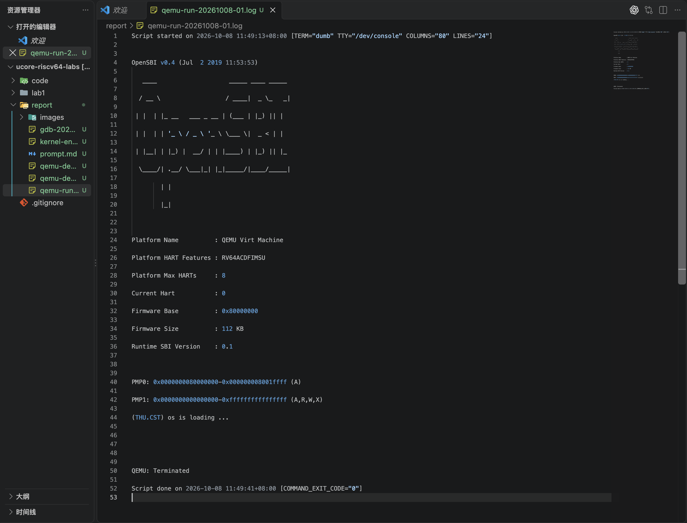
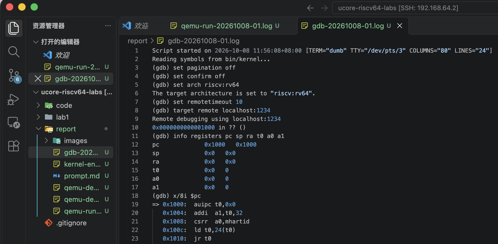
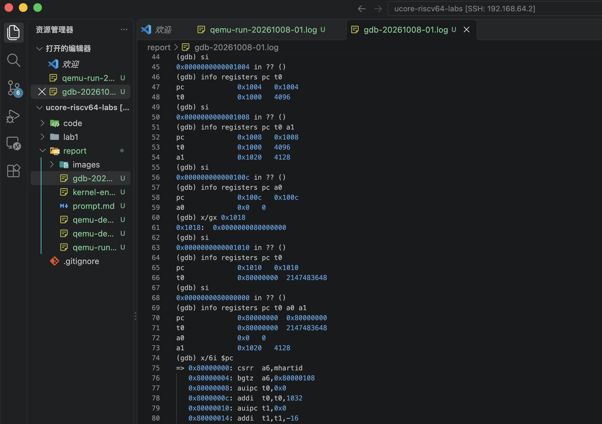
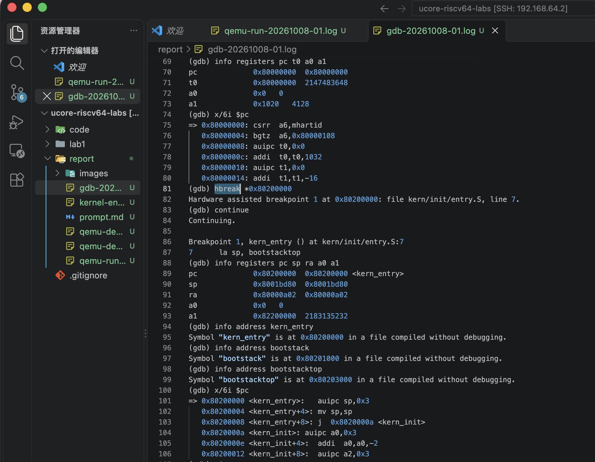
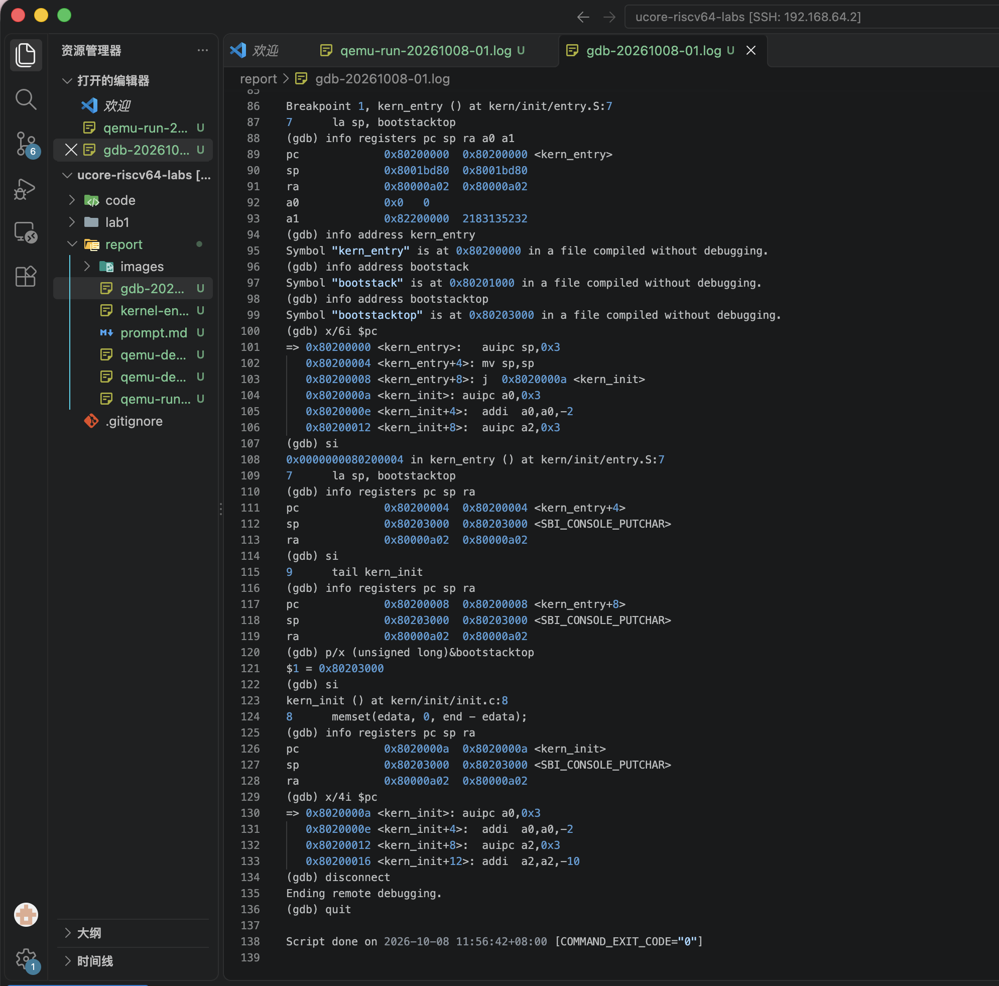

# Lab1 实验报告：比麻雀更小的麻雀（最小可执行内核）

> 本报告记录最小内核的源码分析、运行验证和启动流程调试。测试图片为保存的运行、调试日志截图。

## 实验基本信息

| 项目 | 内容 |
|---|---|
| 实验名称 | Lab1：比麻雀更小的麻雀（最小可执行内核） |
| 小组成员 | 母焯行（2513960）、罗熙媛（2514039）、谢北宸（2513513） |
| 实验操作记录日期 | 2026 年 10 月 8 日 |
| 最终完成日期 | 2026 年 10 月 9 日 |
| 小组仓库 | <https://github.com/dbxxx-ac/ucore-riscv64-labs> |
| 实验分支 | `lab1` |
| 实验源码基线 | `4a0471ebe648dd250dd576e911c484e56e12056d` 提交中的 `code/` |

### 小组分工

| 成员 | 实验操作、练习或模块分工 | 报告撰写与核对分工 |
|---|---|---|
| 母焯行（2513960） | 环境配置、编译运行、执行 GDB 调试并保存记录 | 实验过程、环境与测试结果 |
| 罗熙媛（2514039） | 阅读入口和初始化源码，核对练习 1 的解释 | 练习 1、整体逻辑、核心模块分析 |
| 谢北宸（2513513） | 复核调试日志中的地址、寄存器和断点结果 | 练习 2、截图与提示词整理、格式检查 |

本次使用提供的 Lab1 起始代码。经文件比较，附件中的 21 个普通文件与上述提交的 `code/` 对应文件逐字节一致。实验过程中未修改内核源码和 Makefile，主要工作是源码分析、构建运行、调试验证及报告整理。旧代码包中的实验编号不作为本年度任务范围的判断依据。

## 一、实验目的

1. 理解最小操作系统内核的启动流程，区分复位入口代码、OpenSBI 固件和实验内核的作用。
2. 阅读内核入口汇编，理解初始化栈指针以及从汇编入口转入 C 语言函数的操作和目的。
3. 理解链接脚本对入口和内存布局的安排，了解 BSS 清零及控制台输出等基本初始化功能。
4. 掌握使用 QEMU 运行 RISC-V 内核，以及使用 GDB 查看寄存器、反汇编、单步执行和设置断点的方法。
5. 将源码理解与实际执行结果相互核对，保留真实命令、日志和截图，明确实验结论的证据范围。

## 二、实验环境

### 2.1 开发与运行环境

本报告的运行结果、调试地址、文件路径及五张截图统一对应母焯行的 macOS＋UTM＋Ubuntu 实验环境。其他环境中的操作结果不混入本报告；成员参与源码分析和结果复核，不意味着每位成员都使用了同一台机器。

| 项目 | 本次实验使用的环境 |
|---|---|
| 宿主与虚拟机 | macOS 上通过 UTM 运行 Ubuntu |
| Ubuntu 版本 | Ubuntu 20.04.6 LTS，x86_64 |
| Ubuntu 用户 | `student` |
| 编辑与连接方式 | VS Code，通过 Remote SSH 连接 Ubuntu |
| 本地小组仓库 | `/home/student/oslab/repos/ucore-riscv64-labs` |
| 编译、运行和调试目录 | 上述仓库的 `code/` |
| RISC-V GCC | SiFive GCC-Metal 10.2.0 |
| RISC-V GDB | SiFive GDB-Metal 10.1 |
| QEMU | 4.1.1，使用 `qemu-system-riscv64` |
| 模拟平台 | QEMU Virt Machine |
| 固件 | OpenSBI v0.4，运行输出中的 Runtime SBI Version 为 0.1 |

GCC、GDB 位于 `/home/student/oslab/toolchains/sifive/bin/`，QEMU 位于 `/home/student/oslab/qemu-4.1.1/bin/`。Ubuntu 是编译与调试的工作环境，QEMU 内运行的 RISC-V 最小内核才是本实验研究对象。

### 2.2 AI 工具使用情况

本次使用 AI 辅助源码理解、实验操作、结果核对和报告讨论。下表按成员提供的名称记录 AI 工具及底层模型，不列具体版本。

| 成员 | AI 工具 | 底层模型 |
|---|---|---|
| 母焯行（2513960） | Codex | ChatGPT |
| 罗熙媛（2514039） | Claude Code | DeepSeek |
| 谢北宸（2513513） | Codex | ChatGPT |

同目录的 `prompt.md` 收录本次整理的 8 条四段式任务提示词，涵盖 AI 环境验证、资料核对、本地准备、源码分析、运行及调试。练习 1 和练习 2 的任务提示词也分别列于附录 A、B。该文件不包含未提供的其他组员独立 AI 对话，不将其表述为全组全部历史对话记录。

## 三、实验整体逻辑分析

### 3.1 本章节的逻辑主线

本实验围绕“一个最小内核怎样开始执行”展开。该内核还没有进程调度、虚拟内存管理或文件系统等完整功能，而是先建立基本运行条件，打印启动信息并进入循环。理解这个最小过程，是理解后续内核功能的基础。

实验包含构建与执行两个阶段：首先在 Ubuntu 中将源码构建为内核镜像；随后由 QEMU 模拟 RISC-V 计算机，观察控制流从复位入口经过固件进入内核。练习 1 解释源码意图，练习 2 用实际调试验证关键步骤。

### 3.2 从源码到镜像

执行 `make` 后，构建系统编译 C 源文件和汇编源文件，按照 `tools/kernel.ld` 的安排链接得到 `bin/kernel`，再转换生成 `bin/ucore.img`。

```text
C 源码与汇编源码
    ↓ 编译、汇编
目标文件
    ↓ 按链接脚本链接
bin/kernel：ELF 文件，包含符号和调试信息
    ↓ 镜像转换
bin/ucore.img：供当前 QEMU loader 加载的原始镜像
```

链接脚本使用 `ENTRY(kern_entry)` 指定 ELF 入口，并将内核布局起始地址设为 `0x80200000`。当前 QEMU 命令加载的是原始镜像，GDB 则从 ELF 文件读取符号；两者用途不同。仅有链接脚本中的入口声明，并不能单独证明运行时已经到达该地址，还需要实际调试验证。

### 3.3 从复位到内核初始化

本次观察到的主要执行路线为：

```text
QEMU 准备模拟硬件、固件和镜像
    ↓
0x1000：复位入口代码
    ↓
0x80000000：OpenSBI 固件入口
    ↓
0x80200000：内核入口 kern_entry
    ↓
设置 sp → 跳转到 kern_init
    ↓
源码规定的后续行为：清零 BSS → 输出启动信息 → 无限循环
```

复位代码准备 hart 编号、设备树地址和固件入口地址，再将控制权交给 OpenSBI。固件执行后进入内核入口。这里必须区分“镜像加载到内存”和“CPU 开始执行镜像”：本次启动使用 QEMU 的 `-device loader`；CPU 仍暂停于复位入口时，内核入口处已经存在与镜像相符的内容，因此不能将本次过程描述为已观察到 OpenSBI 在运行期间复制内核。

进入内核后，先设置栈再进入 C 函数，因为编译器生成的 C 函数代码可能使用栈保存数据或调用其他函数。`kern_init` 随后完成基本初始化和输出。运行验证观察到了启动信息；入口单步调试停在 `kern_init` 第一条机器指令前，没有继续逐项验证 BSS 清零或循环执行。

## 四、实验内容与实现

### 4.1 核心模块及接口理解

本次没有新增或修改实验函数。以下是分析的已有核心模块，而非本次自行实现的接口。

| 模块 | 关键文件或接口 | 作用及相互关系 |
|---|---|---|
| 构建系统 | `Makefile`、`tools/function.mk` | 调用交叉工具链生成内核和镜像，并定义 QEMU、GDB 启动目标 |
| 链接布局 | `tools/kernel.ld` | 安排代码、只读数据、数据和 BSS，定义入口及 `edata`、`end` 等边界符号 |
| 汇编入口与启动栈 | `kern/init/entry.S`、`kern/mm/memlayout.h`、`kern/mm/mmu.h` | 预留启动栈，设置 `sp`，转入 C 初始化函数 |
| C 初始化入口 | `int kern_init(void)`，带 `noreturn` 属性 | 清零相关内存区间、打印启动信息，最后无限循环 |
| 格式化输出 | `int cprintf(const char *fmt, ...)`、`int vcprintf(const char *fmt, va_list ap)` | 处理可变参数，借助格式化模块将内容转换为逐字符输出 |
| 控制台与 SBI | `void cons_putc(int c)`、`void sbi_console_putchar(unsigned char ch)` | 将字符输出请求交给 SBI 接口，底层通过 `ecall` 发起调用 |

输出调用关系可概括为：

```text
cprintf → vcprintf → vprintfmt → cputch
        → cons_putc → sbi_console_putchar → sbi_call / ecall
```

这里的 `cprintf` 是实验提供的内核输出函数，不依赖普通用户态程序中的完整标准 C 库运行环境。SBI 调用体现了内核通过约定接口请求固件服务的方式，不能直接等同于用户程序向操作系统发起系统调用。

### 4.2 练习 1：理解内核启动中的程序入口操作

**负责人：罗熙媛（2514039），负责源码分析与练习 1 报告内容。**

入口源码的核心部分为：

```asm
kern_entry:
    la sp, bootstacktop
    tail kern_init

.section .data
    .align PGSHIFT
    .global bootstack
bootstack:
    .space KSTACKSIZE
    .global bootstacktop
bootstacktop:
```

#### 4.2.1 `la sp, bootstacktop` 的操作和目的

`sp` 是 RISC-V 的栈指针寄存器，即 `x2`。`la sp, bootstacktop` 将符号 `bootstacktop` 的地址写入 `sp`，并不是读取该地址处存储的数据。[4]

本次代码中，`KSTACKPAGE=2`、`PGSIZE=4096`，因此：

```text
KSTACKSIZE = KSTACKPAGE × PGSIZE = 2 × 4096 = 8192 字节
```

`bootstack` 位于预留区域的低地址端，`.space KSTACKSIZE` 为栈预留空间，`bootstacktop` 位于该区域末尾之后。标准 RISC-V 调用约定规定栈向低地址增长，因此初始栈指针应放在高地址端。[3]

```text
低地址                                               高地址
bootstack ├────────── 8192 字节预留空间 ──────────┤ bootstacktop
                        ← 栈增长方向                    初始 sp
```

进入 C 函数前要准备有效的栈，因为函数可能保存寄存器、使用局部存储或调用其他函数。若直接进入 C 代码而 `sp` 未指向有效区域，后续栈访问可能破坏其他数据或引发异常。并不是每个局部变量都一定存放在栈上，但调用环境必须允许函数正确使用栈。

启动栈使用 `.align PGSHIFT`，其中 `PGSHIFT=12`，按 4096 字节对齐；栈长度又是两页，因此栈顶也满足标准调用约定要求的 16 字节对齐。[3]

如果将初始 `sp` 设置为低地址端 `bootstack`，函数向低地址分配栈帧时就会越过预留栈区域。这也说明选择 `bootstacktop` 的必要性。

#### 4.2.2 `tail kern_init` 的操作和目的

`tail kern_init` 将控制权转交给 `kern_init`，不建立一个新的返回到当前调用点之后的地址。普通 `call` 会设置返回地址寄存器 `ra`，而这里的尾跳转不为入口创建新的返回路径；这不意味着它将 `ra` 清零。[4]

当前 `kern_init` 声明为：

```c
int kern_init(void) __attribute__((noreturn));
```

其实现最后进入 `while (1)`，不会返回 `kern_entry`，因此入口适合使用 `tail`。`noreturn` 是向编译器声明函数不返回的属性，真正使当前实现保持运行的是函数末尾的循环。

`kern_init` 内部仍可正常调用 `memset`、`cprintf` 等函数。入口不需要接收 `kern_init` 的返回，与初始化函数内部调用其他函数并不矛盾。

#### 4.2.3 `kern_init` 的源码行为

```c
extern char edata[], end[];
memset(edata, 0, end - edata);

const char *message = "(THU.CST) os is loading ...\n";
cprintf("%s\n\n", message);
while (1)
    ;
```

`edata` 和 `end` 由链接脚本定义，清零区间包含 BSS，为相关未显式初始化的静态存储期数据准备零初值。该操作不是清空全部内核数据。随后，`cprintf` 输出启动信息，最后进入循环。

综上，入口操作形成“先建立栈环境，再执行 C 初始化”的顺序。汇编负责为 C 代码准备必要条件，C 代码再完成更容易用高级语言表达的初始化工作。

#### 4.2.4 提示词及实际处理过程

本阶段实际使用的完整四段式提示词见附录 A，同时收录在 `prompt.md` 中。该提示词要求实际读取五个相关文件、解释两条指令、引用源码证据，并禁止修改源码或启动调试。

已有记录显示，本阶段通过一次明确的分析任务得到解释及答案草稿，随后进行了概念核对。这里记录的是分析过程，不将其写为“代码修改迭代”。最初分析没有确认伪指令的具体编码展开；这部分证据在练习 2 的实际反汇编中补充。

### 4.3 练习 2：使用 GDB 验证启动流程

**分工：母焯行（2513960）执行调试并保存记录；谢北宸（2513513）复核日志并整理练习 2 报告。**

#### 4.3.1 调试方法

在 `code/` 中执行 `make debug`，使用 QEMU 的 `-s -S` 参数启动调试：`-s` 提供端口 1234 上的 GDB 连接，`-S` 使模拟 CPU 在开始执行前暂停。[5]

另一会话加载当前构建产物并连接：

```bash
/home/student/oslab/toolchains/sifive/bin/riscv64-unknown-elf-gdb -q -nx bin/kernel
```

```gdb
set arch riscv:rv64
target remote localhost:1234
info registers pc sp ra t0 a0 a1
x/8i $pc
```

使用 `si` 执行一条机器指令，再查看寄存器。对较长的固件执行过程使用硬件断点和 `continue`，没有逐条跟踪完整 OpenSBI。以下数值均限定为本次环境和构建产物的观察，不作为所有 RISC-V 平台的固定结果。

#### 4.3.2 最初指令的地址及功能

第一次继续执行前，实际初始 `PC=0x1000`，`sp=0`、`ra=0`。该位置的前五条指令及单步结果如下：

| 指令执行前的 PC | 反汇编显示 | 实际结果及作用 |
|---|---|---|
| `0x1000` | `auipc t0,0x0` | 执行后 `t0=0x1000`，取得当前位置作为后续计算的基础 |
| `0x1004` | `addi a1,t0,32` | `a1=0x1020`，准备后续传入固件的设备树地址 |
| `0x1008` | `csrr a0,mhartid` | `a0=0`，读取当前 hart 编号 |
| `0x100c` | `ld t0,24(t0)` | 从 `0x1018` 读取八字节入口值，得到 `t0=0x80000000` |
| `0x1010` | `jr t0` | 执行后 `PC=0x80000000`，跳入固件 |

其中，`a1` 的设备树含义由本次寄存器观察与 QEMU 4.1.1 对应源码共同支持：源码将设备树放在 `0x1000` 开始的 32 字节复位代码之后，即 `0x1020`。本轮没有完整解析设备树内容。[2]

因此，对“硬件加电后最初几条指令在哪里、完成什么功能”的回答是：在本次 QEMU RISC-V virt 环境中，最初执行位置为 `0x1000`；这些指令准备启动参数、取得固件入口地址并跳转到固件。`0x1000` 的复位代码、`0x80000000` 的 OpenSBI 和 `0x80200000` 的实验内核应分别描述。

#### 4.3.3 从固件到内核入口

单步到 `0x80000000` 后，查看固件入口处的反汇编，并执行：

```gdb
hbreak *0x80200000
continue
```

实际输出显示命中 `kern_entry`，源码位置为 `kern/init/entry.S:7`；寄存器记录确认 `PC=0x80200000`。此时入口第一条机器指令尚未执行。

这一观察证明本次执行确实到达了指定内核入口。固件内部从 `0x80000000` 到内核入口的区间通过 `continue` 跨过，没有逐条记录其内部初始化或特权级切换，因此不对这些细节作已验证的断言。

#### 4.3.4 栈初始化与进入 `kern_init`

GDB 查询到：

```text
kern_entry   = 0x80200000
bootstack    = 0x80201000
bootstacktop = 0x80203000
```

栈顶与栈底的差值为 `0x2000`，即 8192 字节，与宏定义一致。入口断点处的 `sp` 为 `0x8001bd80`，这是内核重新设置启动栈之前的值。

本次反汇编及单步记录为：

| 执行前的 PC | 反汇编显示 | 执行后的观察 |
|---|---|---|
| `0x80200000` | `auipc sp,0x3` | `sp=0x80203000`，PC 到达 `0x80200004` |
| `0x80200004` | `mv sp,sp` | `sp` 保持 `0x80203000`，PC 到达 `0x80200008` |
| `0x80200008` | `j 0x8020000a` | PC 到达 `kern_init` 的第一条机器指令 |

前两条对应源码中的 `la sp, bootstacktop`。设置完成后，`sp` 与查询得到的 `bootstacktop` 相等。随后执行对应 `tail kern_init` 的跳转，PC 变为 `0x8020000a`，`ra` 在跳转前后均为 `0x80000a02`。

这里使用“反汇编显示”描述 `mv`、`j`，因为它们本身也是伪指令或别名形式。具体显示和编码受工具链、链接处理影响，不能从源码伪指令名称推断在所有构建中都具有相同展开形式。[4]

本次最终停在 `kern_init` 第一条机器指令执行前。虽然 GDB 同时显示 `memset` 所在源码行，这不代表已经执行完清零操作。

#### 4.3.5 关于镜像加载和 watchpoint

本次启动使用：

```text
-machine virt
-nographic
-bios default
-device loader,file=bin/ucore.img,addr=0x80200000
```

调试记录中，在初始 PC 仍为 `0x1000` 时，内核入口处前 16 字节已经与当前镜像相同。结合 loader 配置，可以判断本次镜像由 QEMU 在 CPU 开始执行前装入。

因此，教材关于使用 watchpoint 观察内核加载的建议，需要结合实际加载方式理解。在本次运行中，连接 GDB 后才设置写观察点，不能回溯捕获已经完成的初始加载。本轮未设置 watchpoint，也没有任何命中记录；上述 16 字节比较也不能写成已经逐字节校验了整个镜像。

#### 4.3.6 提示词、问题与处理过程

本阶段实际使用的完整四段式提示词见附录 B，同时收录在 `prompt.md` 中。其重点是要求实际执行、保存命令与输出、明确证据范围，以及结束后退出本轮进程。

第一次启动 QEMU 时，执行环境的沙箱限制阻止创建调试 socket。该失败记录保留在 `qemu-debug-20261008-01.log`。获得执行许可后重试成功，后续调试记录保存在另一个日志文件中。

这个问题发生在调试工具启动阶段，并不是内核代码缺陷；处理过程没有修改源码，也不计为一次内核算法修改。成功调试结束后，GDB 通过 `disconnect`、`quit` 退出，QEMU 通过 `Ctrl+A` 后按 `x` 退出。执行反馈确认没有遗留本轮进程，端口 1234 已释放。

### 4.4 本年度任务范围说明

已核对的练习页面列出以上两道练习，没有独立的必做 Challenge 或需要补全的函数。报告模板中的 Challenge、示例函数及“所有测试通过”等内容不作为本次新增任务或既成结果。本次不实现中断、时钟或其他后续实验模块。

## 五、测试与验证

### 5.1 验证结果与证据范围

| 验证项目 | 本次结果 | 证据与限制 |
|---|---|---|
| 基线编译 | `make` 退出码为 0，生成 `bin/kernel`、`bin/ucore.img` | 依据本地准备阶段执行反馈；本报告五张截图中没有单独的编译过程截图 |
| QEMU 运行 | 输出 OpenSBI 信息和内核启动信息，手动退出后命令退出码为 0 | 图 1；只能证明所观察到的启动表现 |
| 复位入口 | 初始 PC 为 `0x1000`，已记录前五条指令 | 图 2 |
| 复位跳转 | 单步加载目标并进入 `0x80000000` | 图 3 |
| 内核入口 | 硬件断点实际命中 `kern_entry`，PC 为 `0x80200000` | 图 4 |
| 栈与 C 入口 | `sp=bootstacktop=0x80203000`，随后到达 `kern_init` | 图 5 |
| 自动评分 | 未执行 | 当前源码缺少 Makefile 引用的 `tools/grade.sh`，不能报告评分通过 |

QEMU 运行约 28 秒，输出启动信息后没有新增内容，与源码中的无限循环相符。本次手动退出 QEMU，不将“没有新增输出”直接判断为卡死，也不将退出记录解释为内核自行结束。

以下截图均来自原始日志在 VS Code 中的显示，没有将日志查看界面称为实时运行现场。截图已包含在本报告材料包中；原始日志在 Ubuntu 工作副本中留存的情况与当前打包状态见 5.7 节。

### 5.2 运行输出



**图 1：**日志显示 OpenSBI v0.4、QEMU Virt Machine 和 `(THU.CST) os is loading ...`。随后手动退出，记录显示 `QEMU: Terminated` 及 `COMMAND_EXIT_CODE="0"`。

### 5.3 复位入口



**图 2：**连接 GDB 后，CPU 停在 `0x1000`；记录包含初始寄存器及 `x/8i $pc` 显示的前五条启动指令。

### 5.4 单步进入固件



**图 3：**从 `0x1018` 读取固件入口值后，`t0=0x80000000`；执行跳转，PC 从 `0x1010` 转到 `0x80000000`。同时可见 `a0=0`、`a1=0x1020`。

### 5.5 命中内核入口



**图 4：**设置硬件断点并执行 `continue` 后，实际命中 `kern_entry`。PC 为 `0x80200000`，停在入口第一条机器指令执行前。

### 5.6 栈初始化与进入 C 函数



**图 5：**栈顶符号查询及单步记录表明，设置后的 `sp` 与 `bootstacktop` 一致；随后跳转到 `kern_init`，`ra` 保持不变。末尾记录了 GDB 的断开连接和退出。

### 5.7 附件与原始记录清单

本报告材料包实际包含 `report.md`、`prompt.md` 和 `images/` 下的五张截图。

| 包内材料 | 内容 |
|---|---|
| `report.md` | 实验分析、练习答案与结果说明 |
| `prompt.md` | 8 条四段式任务提示词 |
| `images/` | 图 1 至图 5 对应的真实日志截图 |

根据 Ubuntu Codex 的执行反馈，下列 5 份原始日志已保存于 `/home/student/oslab/repos/ucore-riscv64-labs/report/`。本次报告打包未取得这些原始文件，因此当前 ZIP 不含下列日志；此处是记录来源清单，不是包内附件清单。

| 原始日志文件 | 用途 |
|---|---|
| `qemu-run-20261008-01.log` | 普通运行输出、会话起止时间和退出状态 |
| `gdb-20261008-01.log` | GDB 实际命令、寄存器、反汇编及单步输出 |
| `qemu-debug-20261008-01.log` | 首次受沙箱限制的启动失败记录 |
| `qemu-debug-20261008-02.log` | 成功的 QEMU 调试会话记录 |
| `kernel-entry-evidence-20261008-01.log` | 构建产物反汇编和镜像字节等辅助证据 |

## 六、实验总结与收获

### 6.1 与操作系统原理的联系和差异

| 本实验的重要知识点 | 对应的 OS 原理知识 | 含义、联系和差异 |
|---|---|---|
| 复位代码、固件、内核的分阶段启动 | 操作系统引导与初始化 | 体现从底层启动代码到内核的控制权交接。本次使用模拟平台和预加载镜像，没有覆盖真实机器上的磁盘引导、固件菜单和完整引导程序流程 |
| 初始化 `sp`、进入 C 函数 | 内核执行上下文与调用约定 | 栈是函数执行的重要条件，本次使用固定的启动栈；尚未实现多线程或多进程各自的内核栈及上下文切换 |
| 链接地址、ELF 与镜像 | 程序布局、装载与入口 | 展示编译期符号安排与运行期地址的联系。链接脚本规定布局，QEMU loader 负责本次装入，二者不应混同为 CPU 自动完成的工作 |
| BSS 边界与清零 | 静态存储期数据初始化 | 理解程序启动时为何需要准备符合语言约定的初值。这里是固定内核映像的基本初始化，不是动态内存分配或页面管理 |
| 控制台输出与 SBI | 分层接口、特权服务与 I/O | 内核通过 SBI 请求固件输出字符，体现接口分工；不等于本次实现了用户态系统调用或完整设备驱动框架 |
| PC、单步与断点 | 指令执行与控制流 | 用执行证据检验源码理解，认识到伪指令、机器指令及源码行并非始终一一对应 |

本实验还说明，程序已经位于内存中与 CPU 已经执行到该程序是两个不同状态。初始暂停时可以读取内核字节，但 PC 仍在复位入口；只有经过启动控制流，才真正到达 `kern_entry`。

### 6.2 OS 原理中重要但本实验未涉及的内容

1. **进程与线程管理。**本次没有创建用户进程、维护进程状态或进行调度，单一启动栈也不代表完整的线程管理机制。
2. **虚拟内存与页面管理。**实验没有实现页表建立、地址空间隔离、缺页处理、页面分配或置换。源码中的页大小宏不意味着已经实现分页管理。
3. **中断与时钟。**本次没有编写中断分发、定时器中断处理或抢占式调度。
4. **文件系统与持久化存储。**镜像加载和终端输出不涉及文件目录、磁盘块分配、文件缓存或持久化一致性。
5. **同步与并发。**本次没有实现锁、信号量、条件变量或并发任务间的协调。
6. **用户态与系统调用。**本次没有运行用户程序，也没有建立完整的用户态系统调用入口和参数检查机制。

这些内容是完整操作系统的重要组成部分。Lab1 建立的启动环境和调试方法为后续实验提供基础，但本次的启动成功不能证明这些功能已经具备。

### 6.3 AI 协作过程中的经验

本次协作采用分阶段任务：先确认环境和起始代码，再开展源码分析、运行验证及 GDB 调试，最后整理报告与截图。实验分析和验证任务使用 `[PROMPT]`、`[RELY]`、`[GUARANTEE]`、`[SPECIFICATION]` 描述任务、已知条件、交付要求与执行边界。

从已有过程可以总结以下做法：

1. **要求实际操作和证据。**对工具版本、编译结果、断点和寄存器值，要求提供命令及实际输出，不能用提示词中的预期值代替验证。
2. **限制一次任务的范围。**将环境配置、练习分析和报告整理分开，减少误改源码或提前执行无关任务的可能。
3. **核对课程版本。**旧包中同名实验的内容可能不同，应比较实际文件与本年度要求，不能仅按文件夹编号确定任务。
4. **区分工具问题与代码问题。**调试 socket 被沙箱阻止时，先处理执行权限，不将其误判为内核缺陷，也不为此随意修改源码。
5. **保留原始记录。**AI 的概述用于帮助理解，正式结论仍应能回到源码、日志和图片核对；截图只证明画面中出现的内容。
6. **说明未验证范围。**未单步跟踪的固件内部过程、未执行的自动评分和未确认的个人信息，都应如实标明。

本次协作表明，AI 可以辅助整理操作步骤与解释，但源码、实际执行记录和人工复核仍是形成实验结论的依据。将操作、分析和复核分工，并保留证据，比直接接受生成的结论更有助于发现问题。

## 参考资料

1. [2026 年 Lab1 练习要求](http://8.135.34.58/lab2026/_book/lab1/lab1_2_1_exercise.html)及[报告要求](http://8.135.34.58/lab2026/_book/lab1/lab1_5_requirement.html)。具体提交目录按老师后续通知执行：`lab1` 分支根目录的 `code/`、`report/`。
2. [QEMU v4.1.1：RISC-V virt 平台源码](https://github.com/qemu/qemu/blob/v4.1.1/hw/riscv/virt.c)。用于核对复位代码、固件入口与设备树位置。
3. [RISC-V ELF psABI 调用约定](https://riscv-non-isa.github.io/riscv-elf-psabi-doc/)。用于解释寄存器约定、栈增长方向与对齐要求。
4. [RISC-V 汇编手册](https://github.com/riscv-non-isa/riscv-asm-manual/blob/main/src/asm-manual.adoc)。用于解释 `la`、`tail` 和反汇编别名；当前具体指令序列以本次构建产物为准。
5. [QEMU GDB 调试文档](https://www.qemu.org/docs/master/system/gdb.html)。作为 `-s`、`-S`、断点等通用操作参考；本文实验版本为 QEMU 4.1.1。

## 附录 A：练习 1 实际使用的最终任务提示词

以下保留练习 1 的四段式任务提示词；它也收录于 `prompt.md` 的 8 条任务记录中。

```text
[PROMPT]

现在开始本年度 Lab1 的练习 1：理解内核入口与栈初始化。

请实际读取当前工作副本的源码，围绕 kern/init/entry.S 中的以下两条指令，解释它们的操作和目的：

    la sp, bootstacktop
    tail kern_init

先帮助我理解，再给出可用于后续报告的答案草稿。本轮不开展练习 2，不启动 QEMU，不进行 GDB 调试，不修改实验源码。

[RELY]

已完成的本地准备：
- 仓库：/home/student/oslab/repos/ucore-riscv64-labs
- 分支：lab1
- 上轮提交：4a0471ebe648dd250dd576e911c484e56e12056d
- 实验代码目录：上述仓库的 code/
- 上轮 make 返回 0，已经生成 code/bin/kernel 和 code/bin/ucore.img。
- 源码和 Makefile 未修改，未提交或推送。
- 根目录 report/prompt.md 已保存上一轮实际提示词。

本年度练习 1 要求分析入口文件中的两条指令及其在启动流程中的作用。当前源码是设置栈、进入 kern_init、清零 BSS、打印并循环的最小内核。

交接资料位于：
/home/student/oslab/lab1-handoff

[GUARANTEE]

本轮不新增或修改实验函数，不改变函数接口。

本轮交付：
1. 基于实际源码的两条指令解释；
2. 与解释相关的文件路径、行号及关键代码；
3. 一份练习 1 答案草稿，在对话中展示；
4. 将本条完整提示词追加到 report/prompt.md，保留已有内容。

[SPECIFICATION]

前置条件：
1. 确认当前操作的是小组仓库工作副本，检查分支和工作区状态。
2. 保留上一轮新建的 report/ 及其他已有文件，不重置、不覆盖。若实际代码与上述基线不同，说明相关差异。

源码阅读：
实际读取 code/ 下的：
- kern/init/entry.S
- kern/init/init.c
- kern/mm/memlayout.h
- kern/mm/mmu.h
- tools/kernel.ld

必要时只读查看其他直接相关文件。

分析要求：
1. 解释 sp 是什么，以及 la sp, bootstacktop 是把地址放入寄存器，还是读取该地址中的内容。
2. 根据实际源码指出 bootstack、bootstacktop、KSTACKSIZE 的定义，计算栈大小，并解释栈增长方向与选择栈顶的关系。
3. 解释为什么进入 C 函数前需要建立有效的栈。
4. 解释 tail kern_init 的控制流效果，与普通 call 在返回地址处理上的区别，并结合 kern_init 不返回的实际行为说明。
5. 明确 la 和 tail 是汇编伪指令。若没有查看当前构建产物的反汇编，不要把某一种展开形式说成当前二进制中的确定结果。
6. 简要串联链接入口、kern_entry、栈初始化与 kern_init 的关系。区分源码或链接脚本证据与实际运行观察。
7. 简要解释 kern_init 的 BSS 清零、输出和循环行为。本轮不要扩展到中断、时钟或后续实验。

输出顺序：
1. 先用适合初学者的语言解释；
2. 再给出紧扣两条指令的答案草稿，并标注源码依据；
3. 最后给我两个简短自测问题，暂不附答案，让我确认是否理解。

执行限制：
- 只允许追加修改根目录 report/prompt.md，本轮不创建或修改正式 report.md。
- 不修改源码、Makefile、系统配置或其他已有文件。
- 不重新编译、不启动 QEMU、不执行 GDB、不执行 make grade。
- 不提交或推送 Git。
- 不把源码推断描述成已经观察到的调试结果。
- 本轮只追加当前实际提示词，不声称已汇总所有历史提示词。

完成后说明实际读取了哪些文件、修改了哪个文件，以及本轮是否遇到无法确认的问题。
```

## 附录 B：练习 2 实际使用的最终任务提示词

```text
[PROMPT]

现在开始本年度 Lab1 练习 2：使用 QEMU 和 GDB，实际观察从复位暂停状态到内核入口的启动过程。

请执行真实调试并保存记录，解释最初执行的指令及其功能，然后跟踪到内核入口。不要仅根据教材或预期地址生成答案。

本轮完成调试记录与答案草稿，不撰写完整实验报告，不修改实验源码。

[RELY]

工作副本：
/home/student/oslab/repos/ucore-riscv64-labs

编译和调试目录：
/home/student/oslab/repos/ucore-riscv64-labs/code

当前分支：lab1。
此前已实际编译成功，并通过 make qemu 观察到 OpenSBI 和内核启动信息，随后正常退出，无遗留本轮 QEMU 进程。

工具目录：
- /home/student/oslab/toolchains/sifive/bin
- /home/student/oslab/qemu-4.1.1/bin

版本：GCC 10.2.0、GDB 10.1、QEMU 4.1.1。

Makefile 的 debug 目标使用 -s -S，使用 -device loader 将 bin/ucore.img 放到指定内存地址。
链接脚本将内核布局起始地址设为 0x80200000。

上述地址和配置属于待结合实际调试验证的背景，不得代替本轮观察。

课程资料位于：
/home/student/oslab/lab1-handoff
手册：
http://8.135.34.58/lab2026/_book/lab1/lab1_2_1_exercise.html

[GUARANTEE]

不新增或修改实验函数，不改变函数接口。

本轮交付：
1. 实际使用的 QEMU、GDB 启动方式；
2. 包含执行命令和对应输出的原始调试日志；
3. 最初指令地址、反汇编、关键寄存器及跳转目标的观察记录；
4. 到达内核入口的实际断点记录；
5. 练习 2 答案草稿，以及仍未验证的事项；
6. 向 report/prompt.md 追加本条完整提示词。

[SPECIFICATION]

准备：
1. 核对本地工作目录、分支及相关 Makefile 目标，保留已有工作。
2. 阅读练习 2 的要求；若网页无法读取，明确说明并使用已有交接资料，不编造网页内容。
3. 检查相关 QEMU/GDB 进程和调试端口，避免连接到旧实例。
4. 不终止无关进程。若端口被其他会话占用，说明情况。

实际调试：
1. 启动当前代码的 make debug，并在另一工具会话中连接 GDB、加载当前 bin/kernel。
2. 在第一次 continue 或单步之前，记录真实初始 PC，查看其附近的反汇编和必要寄存器。
3. 对复位入口最初的短指令序列进行实际单步，记录关键寄存器变化、内存加载值和实际跳转目的地，逐条解释作用。
4. 根据实际证据区分复位入口代码、OpenSBI 固件和实验内核，不把它们混称为同一个程序。
5. 对较长的固件执行过程使用适当断点继续运行，不必逐条单步整个 OpenSBI；明确哪些区间通过 continue 跳过。
6. 在内核入口第一条指令执行前停住，记录 PC、附近反汇编及 kern_entry 符号地址。必要时使用硬件断点，避免写入只读区域。
7. 继续观察入口设置栈和转入 kern_init 的过程，比较设置后的 sp 与 bootstacktop 符号地址。机器指令以本轮反汇编为准，不机械假定一条伪指令只对应一步。
8. 到达 kern_init 后结束本轮主要观察，不扩展到中断、时钟或其他实验。

关于内核镜像加载：
- 在初始暂停时检查内核入口处是否已有与当前镜像相符的内容。
- 结合 Makefile 的 loader 配置解释观察结果。
- 不预先断言是 OpenSBI 在运行期间复制内核。
- 如果课程提及 watchpoint，应说明在当前加载方式下是否适用；没有命中不能写成命中。

记录与退出：
1. 将 GDB 命令、实际输出以及 QEMU 输出保存到根目录 report/ 下，不覆盖已有日志。
2. 清晰区分“实际观察”“源码或配置推断”“未验证事项”。
3. 每次继续运行都应有明确的断点或有限等待；若异常停滞，暂停并检查，不无限等待。
4. 完成后退出本轮 GDB 和 QEMU，确认没有遗留本轮进程。
5. 原文追加本条提示词到 report/prompt.md。

限制：
- 不修改源码、Makefile、系统配置或旧包。
- 不执行 make clean、make grade，不安装软件。
- 不提交或推送 Git。
- 不伪造日志、截图、寄存器值、断点命中或单步记录。
- 可以保存必要的调试辅助脚本，但应说明路径和用途，不覆盖已有文件。
- 如果无法执行某项调试，明确报告障碍和已完成范围。

最终输出：
1. 按实际观察整理启动流程表：阶段、PC、关键指令或事件、作用、日志依据。
2. 给出练习 2 答案草稿，明确未逐条跟踪的区间。
3. 告诉我最值得截图的 2～3 处记录，以及如何在 VS Code 中查看。
4. 列出新增或修改的文件、进程退出情况和仍未完成的事项。
```
