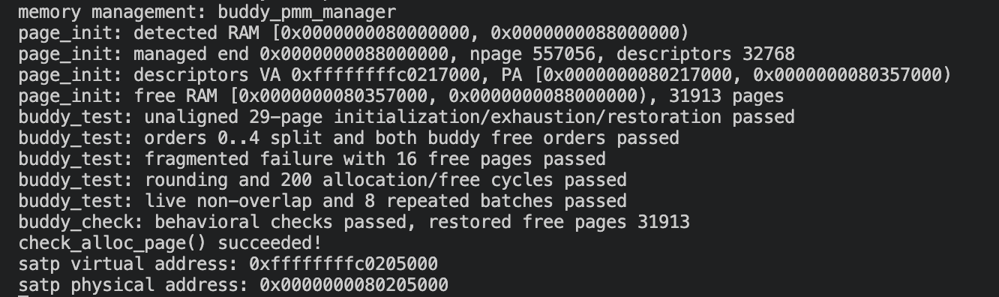
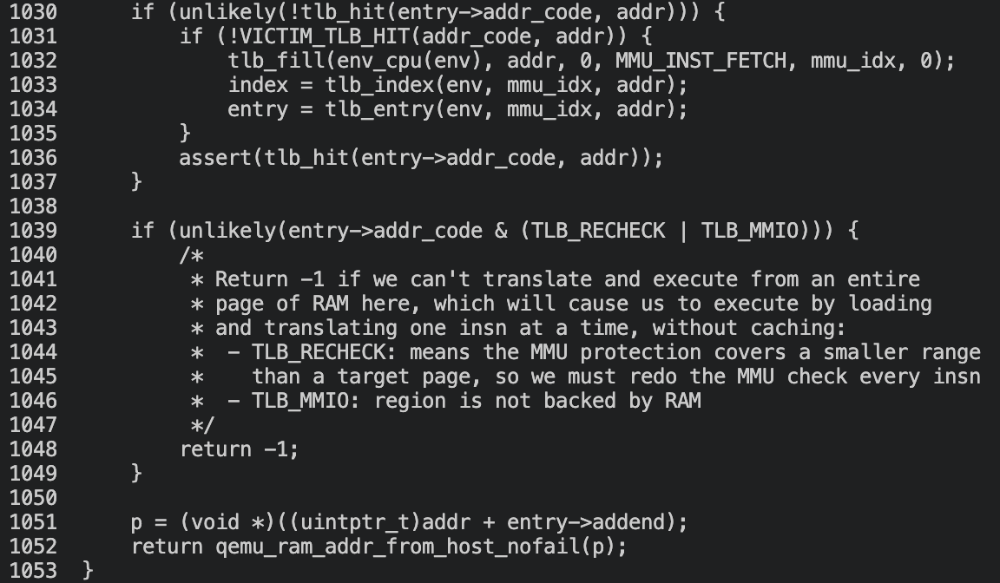
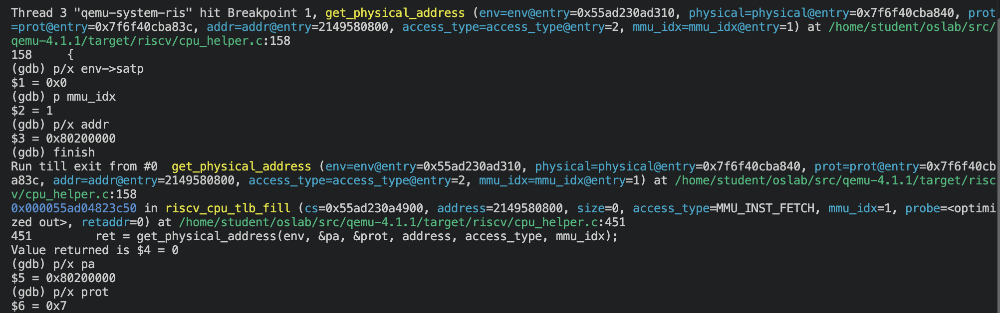
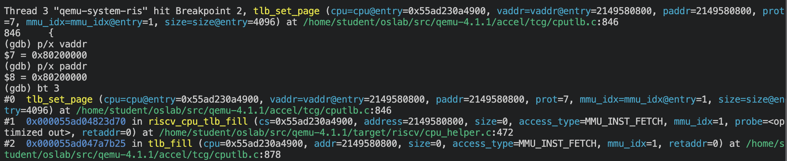
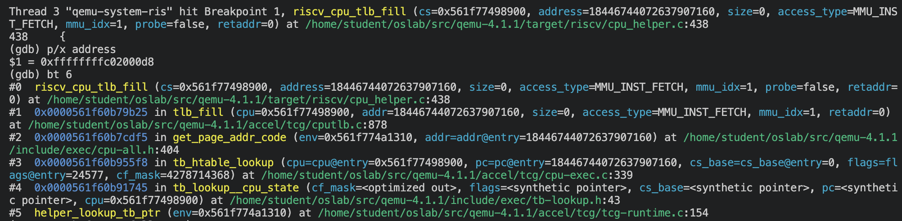
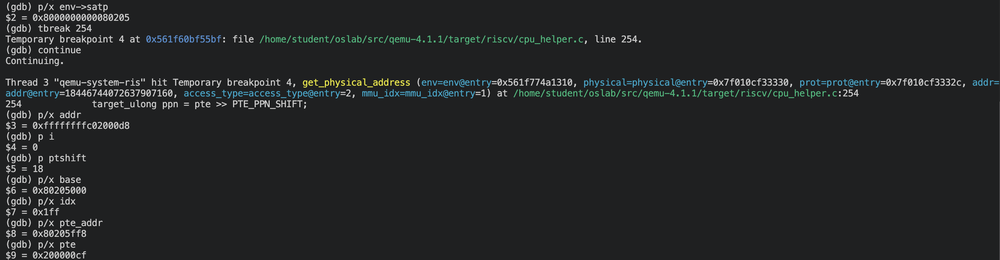
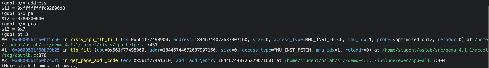
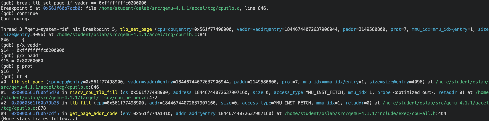

# Lab2 实验报告：物理内存管理与 QEMU 地址转换调试

> 小组成员：母焯行（2513960）、罗熙媛（2514039）、谢北宸（2513513）。分工：`page_init()` 由母焯行负责，Best-Fit 由罗熙媛负责，Buddy System 由谢北宸负责。

> 整理日期：2026 年 10 月 23 日；SLUB 章节及一致性更新于 2026 年 10 月 24 日。本报告核对了原报告和[原始提示词](prompt.md)，并结合真实调试输出与八张截图整理。原报告截至 Buddy 行为测试，QEMU 调试章节由后续终端记录补入，SLUB 实现及独立行为测试记录见后续两阶段章节。不把未执行的边界测试写成已通过。

> 当前构建配置（2026-10-24）：默认选择 Best-Fit；仅在定义 `LAB2_BUDDY_CHALLENGE` 时选择 Buddy 并运行 SLUB 初始化和行为测试。下文此前 Buddy/SLUB 的输出保留为当时配置的历史记录；最新评分与切换命令见文末“默认评分配置修正”。

## 一、实验信息与整体流程

实验仓库为 `/home/student/oslab/repos/ucore-riscv64-labs-lab2`，分支为 `lab2`；原始 Lab2 基线提交为 `7f08393858412b999afb9b277e7a86fb911dd68c`。本次在 macOS 上通过 Ubuntu 20.04 虚拟机开发，以 Remote SSH 使用 VS Code。RISC-V 内核运行于 QEMU 4.1.1 的 `virt` 机器；宿主 QEMU 源码调试使用 Ubuntu 的 x86-64 GDB，客户内核调试使用 RISC-V GDB。

本章把“发现内存”逐步推进到“分配内存”：`dtb_init()` 先从设备树读取 RAM 范围；`pmm_init()` 选择并初始化物理内存管理器；`page_init()` 根据内核、描述符数组和 DRAM 边界划出可分配区，再通过 `init_memmap()` 登记空闲页；最终 `alloc_pages()`、`free_pages()` 由当前管理器实现。我们先分析 First-Fit，再实现 Best-Fit 和 Buddy System，最后从 QEMU 宿主源码观察页表翻译与软件 TLB 的路径。

```text
设备树内存信息 → page_init() 建立 Page 描述符和空闲区
             → pmm_manager 接口 → First-Fit / Best-Fit / Buddy
             → QEMU 中观察 Bare、Sv39 翻译与 TLB 填充
```

课程把“获取未知硬件可用内存范围”思考题及 SLUB 标为 Challenge 选做。SLUB 选做项已实现并通过独立行为测试，具体覆盖与限制见后续两阶段章节；“获取未知硬件可用内存范围”的 Challenge 仍未实施。其余任务的完成范围见下文及文末待办。

### 1.1 各练习的规格与提示词组织

课程规格先限定**必须完成的行为**，再由提示词给 AI 明确工作目录、依赖资料、不能改动的范围和实际验证方式。早期保存的八条完整原始提示词见同目录 [prompt.md](prompt.md)，依次是：独立目录准备、`page_init()` 只读分析、`page_init()` 实现验证、First-Fit 分析、Best-Fit 实现、Buddy 实现、Buddy 独立测试、QEMU 调试环境阅读与计划。这八条均采用 `[PROMPT]`、`[RELY]`、`[GUARANTEE]`、`[SPECIFICATION]` 四部分：先写清当前目标和已知环境，再列出保护范围与可核验结果，避免把计划误写为测试。后续另保存了 SLUB 实现、独立测试两份提示词，合计十条；SLUB 两份提示词的用途与结果见后续章节。主要约束如下。

| 练习 | 规格中的关键行为 | 提示词如何限定 AI |
| --- | --- | --- |
| `page_init()` | 读 DTB 范围、排除占用、设置描述符与空闲区 | 先只读梳理地址关系，再仅实现本函数；真实构建运行，记录失败和边界未覆盖项 |
| First-Fit | 解释初始化、分配、释放、合并及改进空间 | 只读 `default_pmm.c` 与接口，手工推演链表和页数；不能把源码分析写成新的实测 |
| Best-Fit | 最小适配、拆分、回收合并，既有测试通过 | 保护 `basic_check()`、`best_fit_check()` 与 Makefile；必须恢复默认构建，不能排除模块绕过失败 |
| Buddy 实现 | 二次幂块、拆分、同阶伙伴合并并接入内核 | 先定义页数取整、计数和释放约定；基本检查只证明启动范围 |
| Buddy 测试 | 独立设计并运行边界及行为测试 | 覆盖非对齐、各阶、耗尽、碎片、恢复、重叠；核对整块释放约定与现有调用 |
| QEMU 调试 | 演示地址转换、页表遍历和 TLB 路径 | 先核对带符号 QEMU、两个 GDB 和源码位置；原第八条提示词只负责计划，实际调试记录见第四节 |

这份 `prompt.md` 是本次已保存的 AI 任务提示词，不声称包含所有口头问答或其他组员的独立对话。后续逐步调试时的问题与实际结果通过第四节记录。

## 二、物理内存初始化：`page_init()`

### 2.1 规格与提示词思路

课程要求在 `code/kern/mm/pmm.c` 中实现 `static void page_init(void)`：从设备树 getter 取得 RAM 起点和长度，检查有效性；排除 OpenSBI、内核镜像和 `Page` 描述符数组占用；正确设置 `va_pa_offset`、`npage`、`pages`；将剩余完整空闲页交给当前管理器。无效内存信息应终止初始化，没有完整空闲页时不得调用要求 `n>0` 的 `init_memmap()`。原始[只读分析提示词和实现提示词](prompt.md)分为两轮：先梳理 DTB、链接符号、内存布局和调用顺序，再限定实现本练习并记录真实构建及 QEMU 输出。

### 2.2 核心实现与地址关系

`dtb_init()` 从设备树 `memory` 节点读取 RAM 范围，`page_init()` 使用 `get_memory_base()`、`get_memory_size()`，不重新解析设备树。当前固定布局以 `DRAM_BASE=0x80000000` 为起点，默认探测区间为 `[0x80000000,0x88000000)`。`[0x80000000,0x80200000)` 留给 OpenSBI，之后是内核；链接符号 `end` 是内核末尾的虚拟地址，不能直接作为物理地址使用。

`pages` 指向连续的 `struct Page` 描述符数组。一个描述符对应一个物理页，但描述符不是物理页内容；描述符数组自身也消耗物理内存。`nbase=DRAM_BASE/PGSIZE` 是起始物理页号，`npage` 是可管理物理页号的上界，所以描述符数量是 `npage-nbase`，不是 `npage`。实现先验证 DTB 范围及溢出、固定 DRAM 起点和管理上界；将内核末尾上取整为数组起点，计算数组物理末尾并检查容量；再把所有描述符初始化为保留，最后把描述符之后的完整页登记为可分配区。这样不会把内核或描述符数组再次分配出去。

据此前的 Buddy 版本实际 QEMU 输出，本轮布局为：

| 项目 | 实测值 |
| --- | --- |
| 探测 RAM | `[0x80000000, 0x88000000)`，128 MiB |
| `npage` / 描述符数 | `557056` / `32768` |
| 链接符号 `end` | `0xffffffffc0216c68` |
| 描述符虚拟地址 | `0xffffffffc0217000` |
| 描述符物理区间 | `[0x80217000, 0x80357000)` |
| 初始可分配区间 | `[0x80357000, 0x88000000)`，`31913` 页 |

上述 `31913` 是**当时含 Buddy 测试静态数据、尚未加入 SLUB 的镜像**的数值；后续 SLUB 独立测试镜像的基线为 `31910`，见第二阶段记录。早先较小镜像曾测得 `31929` 页；内核镜像大小改变会推后描述符和空闲区起点，不应把两次输出混写成同一次结果。

原报告记录的第一轮 `page_init()` 验证中，`end=0xffffffffc0206078`，描述符从虚拟地址 `0xffffffffc0207000` 开始，每个 `Page` 为 40 字节，总占 `0x140000` 字节；对应物理区间 `[0x80207000,0x80347000)`，空闲区从 `0x80347000` 开始，共 `31929` 页。固定虚实偏移为 `0xffffffff40000000`。该轮默认 `make` 因尚未完成的 Best-Fit 引用未定义 `free_list`、`nr_free` 而失败；仅在这一阶段用命令行临时排除未接入模块完成限定构建，日志为 `page-init-build.log`、`page-init-build-scoped.log`、`page-init-qemu.log`。后续 Best-Fit 完成后已恢复**不排除任何模块**的默认构建；两种构建结果必须分别说明。



已运行的常规启动验证不能代替异常 DTB、地址溢出、异常 RAM 起点、无完整空闲页等故障路径测试；这些边界分支尚未动态覆盖。

## 三、First-Fit、Best-Fit 与 Buddy System

### 3.1 First-Fit 源码分析与改进空间

`default_init()` 初始化带哨兵的双向空闲链表，并令空闲页数 `nr_free=0`。`default_init_memmap(base,n)` 将经过确认的连续页初始化为空闲块，只把块首描述符接入链表；块首的 `property` 记录页数，`PG_property` 标记它是块首。`default_alloc_pages(n)` 从低地址端扫描，选择第一个长度至少为 `n` 的块；若块更大，从前端取出 `n` 页，再把剩余部分以新的块首插回。`default_free_pages(base,n)` 按地址插入归还块，并与前后相邻块合并。`nr_free` 统计空闲**页数**，不是链表节点数；合并不会重复增加它。

例如登记连续的 P0～P9 共十页，链表由空变为 `[0:10]`、`nr_free=10`；分配三页后为 `[3:7]`、7 页，再分配两页后为 `[5:5]`、5 页。归还 P0～P2 得 `[0:3,5:5]`、8 页；归还 P3～P4 后，前后两块相邻，合并恢复 `[0:10]`、10 页。链表修改的是描述符与链接，并不搬动物理页内容。这一推演来自源码分析，不是独立动态测试。

已有实现具备相邻块合并，不能把它写成待补功能。空闲块数为 `k` 时，线性扫描的分配与释放插入最坏需 `O(k)`；可用树结构或索引优化查询，但会增加维护复杂度。即使总空闲页数足够，页被在用块隔开时仍可能无法满足连续大块请求。页内不足一页的浪费也不是只改选块策略就能消除的。

### 3.2 Best-Fit：规格、实现与验证

课程要求在 `code/kern/mm/best_fit_pmm.c` 的指定位置完成管理器及注册结构，保留既有 `basic_check()`、`best_fit_check()` 测试函数，并在 `pmm.c` 中接入。原始 [Best-Fit 提示词](prompt.md)先要求核对两个测试依赖的 `free_list`、`nr_free` 状态，再遵循 `struct pmm_manager` 接口选择满足请求的**最小**空闲块，正确拆分、按地址释放并合并相邻块；不得修改既有测试或 Makefile，也不得把排除模块后的限定构建称为默认构建。实现对同样大小的候选块优先选低地址，`free_list` 按地址升序组织，保留了既有测试保存和恢复链表状态的约定。

第一次默认 `make` 因 Best-Fit 模块尚未完成、引用未定义的 `free_list` 和 `nr_free` 而失败；这不是 `page_init()` 编译错误。完成 Best-Fit 模块后，原报告记录默认 `make -C code` 退出码为 `0`，`make qemu` 输出 `memory management: best_fit_pmm_manager` 与 `check_alloc_page() succeeded!`；经管理器 `check` 接口调用的 `best_fit_check()`（内含 `basic_check()`）正常返回，没有触发断言。没有修改测试函数或 Makefile。远程报告目录保留了 `best-fit-build.log`、`best-fit-qemu.log` 等共九份构建和运行日志；本轮核对了文件名，未逐份重新分析内容。

Best-Fit 减少某些分配情形对大块的切割，但每次查找最小合适块仍需扫描空闲块，最坏为 `O(k)`。可按块长建立辅助索引以改善查找时间，代价是释放、拆分与合并时也要同步维护索引；它也不能保证消除外部碎片。

### 3.3 Buddy System：规格、实现与验证

课程要求两份独立提示词：第一份从零生成 Buddy 分配模块并接入 `pmm_manager`，第二份专门设计相应测试。原始 [Buddy 实现和测试提示词](prompt.md)明确把两阶段分开：先约定二次幂块、初始化非二次幂区间、请求页数取整、计数与释放规则，仅做最小启动检查；再设计覆盖非对齐、各阶拆分合并、耗尽、碎片、计数恢复和多批互不重叠分配的独立行为测试，不能把预期断言终止报告为正常启动通过。

实现新增 `code/kern/mm/buddy_pmm.c` 和 `.h`，并通过 `pmm.c` 选择 `buddy_pmm_manager`。申请 `n>0` 页时，实际占用最小且不小于 `n` 的二次幂页数。块首保留原请求页数；释放必须传回原块首和原请求数，按实际占用页数调整空闲计数。初始化面对非二次幂、非对齐可用区时，按可容纳且对齐的块逐段登记；释放时用页索引 XOR 同阶块长度寻找伙伴。

当前实现维护 0～15 阶空闲链表；`property` 在**空闲块首**记录阶数，`PG_property` 区分阶 0 与普通非块首页。测试先用 64 个静态合成描述符建立隔离区，保存并恢复真实管理器状态；静态覆盖数组与布局快照检查块不重叠、伙伴应合并和计数一致，避免把大数组放在较小的启动栈上。之后再测试真实空闲区。释放约定仍是“原块首＋原请求页数”；First-Fit、Best-Fit 的自检里存在部分释放，本 Buddy 实现不能直接执行它们的那种调用。原报告核对了当前内核除管理器自检外没有依赖部分释放的调用，但未来调用方若需要此能力，必须扩展接口语义及元数据。

此前实际构建和 QEMU 启动均成功。动态检查包括非对齐 29 页区间的登记、耗尽与恢复；阶 0～4 的拆分和两种释放顺序；仍有 16 页空闲但无法申请连续 2 页的碎片情形；200 次分配释放；以及 8 批真实可用区中的多块互不重叠分配。输出显示 `buddy_check: behavioral checks passed, restored free pages 31913` 和 `check_alloc_page() succeeded!`。这些测试通过不同初始形状、分配顺序和释放顺序检查链表、伙伴合并、计数及恢复；它们没有证明并发安全、随机长期压力、物理页内容隔离，也未动态覆盖错误页数或双重释放断言路径。

Buddy 第一阶段仅有最小检查时，默认 `make` 和 QEMU 成功，输出 `buddy_check: minimal checks passed, free pages 31929`；原报告记录在 `buddy-build.log`、`buddy-qemu.log`。独立测试阶段再次默认构建并运行，日志为 `buddy-tests-build.log`、`buddy-tests-qemu.log`，测试结束恢复当轮基准 `31913` 页。两轮的验证范围不同，不能用最小检查输出代表完整行为测试。

当前 Buddy 接口不支持 First-Fit 测试采用的部分释放方式，因此不能声称它可直接替换所有依赖部分释放的调用。此约束需要在答辩中明确说明。

## 四、QEMU 页表查询与 TLB 调试分支

### 4.1 双重调试方法

QEMU 使用 `-s -S` 启动并暂停客户 CPU。宿主 Ubuntu GDB 附加到带符号的 QEMU 进程，以观察 `target/riscv/cpu_helper.c` 和 `accel/tcg/cputlb.c`；另一个 RISC-V GDB 通过 QEMU 的 1234 端口调试客户内核。原始 [QEMU 调试提示词](prompt.md)只要求核对环境并制定三终端步骤，未把当时尚未执行的调试写成结果。后续实际使用 QEMU 源码树中的带符号二进制，启动时通过 `make debug QEMU=/home/student/oslab/src/qemu-4.1.1/riscv64-softmmu/qemu-system-riscv64` 临时指定路径，未改 Makefile 或安装替换日常 QEMU。当前二进制具有调试符号，但构建优化参数为 `-O2 -g`，局部变量可能显示为 `<optimized out>`，因此关键值以实际停下的位置和打印结果为准。

对真实客户取指的调用栈，前次调试观察到：

```text
get_page_addr_code() 中 TLB 查询未命中
  → tlb_fill()
  → riscv_cpu_tlb_fill()
  → get_physical_address()
  → tlb_set_page()
```

`get_page_addr_code()` 的源码先检查当前 TLB 项的 `addr_code`，未命中时再检查 victim TLB，仍未命中则调用 `tlb_fill()`，之后重新读取条目并确认命中。下面图片证明**源码中存在这条路径**；本次已实测未命中与填充，尚未单独动态捕获一次命中分支，不能把源码截图当作“命中已实测”。



### 4.2 Bare 阶段：地址相等但仍使用软件 TLB

在客户内核物理入口 `0x80200000` 处，宿主 GDB 实际停在 `get_physical_address()`：`env->satp=0`、`mmu_idx=1`、`access_type=2`（取指），输入地址 `0x80200000`，输出 `pa=0x80200000`、`prot=0x7`。因此该阶段无需走 Sv39 页表，取指地址与物理地址相同。随后实际停在 `tlb_set_page()`，观察到虚拟页和物理页均为 `0x80200000`，填充大小为 `4096` 字节，调用栈经过 `riscv_cpu_tlb_fill()` 和 `tlb_fill()`。这说明 QEMU 的软件 TLB 不只服务于“已经开启分页”的客户内核，它也是模拟器缓存客户地址到访问宿主内存所需信息的执行机制之一。





### 4.3 Sv39 阶段：页表遍历与映射结果

同一次新调试会话中，高地址取指 `0xffffffffc02000d8` 进入 `riscv_cpu_tlb_fill()`，调用栈经 `tlb_fill()`、`get_page_addr_code()` 等函数。`get_physical_address()` 中读到 `satp=0x8000000000080205`：最高模式位对应 Sv39，根页表物理地址为 `0x80205000`。在页表遍历处观察到顶层索引 `idx=0x1ff`、页表项物理地址 `pte_addr=0x80205ff8`、页表项 `pte=0x200000cf`、`i=0`、`ptshift=18`。





这次地址转换的关键分支和计算过程如下：

1. `mmu_idx=1`、`satp` 模式为 Sv39，因此这次没有走 M 模式或 Bare 的直接返回分支。源码选择三级页表、每级 9 位索引、每个 PTE 为 8 字节；`satp` 的 PPN 给出根页表物理基址 `0x80205000`。
2. 从虚拟地址抽取顶层索引 `0x1ff`，所以本级读取位置是 `0x80205000 + 0x1ff × 8 = 0x80205ff8`。GDB 在读取后观察到 PTE 为 `0x200000cf`。
3. 该 PTE 的 `V/R/W/X/A/D` 位已置位；`R` 或 `X` 使其成为叶子，取指权限检查后形成 `prot=0x7`。此时 `i=0`、`ptshift=18`，说明顶层已经是 1 GiB 大页，不会继续下降到第二、第三层。这解释了源码虽有逐级遍历循环，本次却只读到一个 PTE。
4. PTE 的 PPN 为 `0x80000`，对应 1 GiB 大页物理基址 `0x80000000`。虚拟地址在该大页内的偏移为 `0x2000d8`，因此目标字节的物理地址是 `0x802000d8`。QEMU 为 TLB 返回的 `pa=0x80200000` 是目标所在的物理页基址；页内偏移 `0xd8` 在访问时保留。

随后同一地址对应的 `tlb_set_page()` 实测参数为 `vaddr=0xffffffffc0200000`、`paddr=0x80200000`、`prot=7`、`size=4096`。较早一次会话还曾记录下一页的映射 `0xffffffffc0201000` 到 `0x80201000`，但本次截图只证明前一页。





以上四张 Sv39 图片来自同一次调试会话，连续记录了高地址取指、PTE 读取、翻译结果和 TLB 填充。它们证明一次未命中与填充；尚未单独动态捕获一次命中分支。

QEMU 软件 TLB 与真实 CPU TLB 的共同逻辑是缓存近期转换、未命中时查询映射并填充；QEMU 软件实现还需缓存快速访问宿主内存所需的条目信息，其数据结构、替换和时序不能当作真实芯片硬件 TLB 的逐项复刻。单次断点没有停在 C 查询函数，也不能推出“没有查询 TLB”，因为 TCG 可走已生成的宿主快路径。

### 4.4 调试中的真实问题

早期一次会话在写入 `satp` 后仍尝试对低物理入口设置硬件断点；此时低地址已不再按原方式映射，GDB 报 `Cannot access memory`。随后单步出现取指页错误，手动改 `$pc` 后客户 GDB 又报告多次 `Invalid remote reply`。现有记录不能单独证明这些回复错误的唯一原因。处理方式是结束受影响会话、重新启动 QEMU，不再手动修改 PC，改为从宿主 GDB 对高地址实际取指设置条件断点；后续成功捕获上述 Sv39 翻译和 TLB 填充。助教最近建议在客户 GDB 使用 `set remotetimeout unlimited` 以减少 `Ignoring packet error` 干扰；本次已将其列入操作步骤，但没有独立对照试验，不能断定它单独解决了早期异常。

## 五、知识点对照与实验边界

| 实验中看到的机制 | 对应 OS 原理 | 关系与区别 |
| --- | --- | --- |
| DTB 报告 RAM 范围 | 硬件发现与内存布局 | OS 必须知道哪些地址是真实 RAM、哪些已保留，才能安全管理物理页 |
| `Page` 描述符与空闲链表 | 物理页分配 | 描述符是管理元数据，不是页内容；链表块首代表连续可用页区间 |
| First-Fit / Best-Fit / Buddy | 连续分配与碎片 | 三者选择、拆分和合并策略不同；Buddy 的二次幂占用还带来内部碎片 |
| Sv39 PTE 与 `satp` | 页表、地址转换 | `satp` 指向根页表；有效叶子 PTE 与页内偏移共同确定物理地址 |
| QEMU 软件 TLB | TLB 缓存 | 保留命中/未命中/填充的逻辑，但同时服务于模拟器自身快速访问宿主内存 |

OS 原理中还包括虚拟页分配、缺页异常处理、页面置换、交换空间、进程地址空间隔离、并发分配与锁等；本次 Lab2 主要完成物理页分配及 QEMU 翻译观察，不能从当前测试推断这些完整机制已经实现。SLUB 选做项已实现并通过独立行为测试，覆盖与未覆盖范围见后续第二阶段记录；“获取未知硬件可用内存范围”的 Challenge 仍未实施。

## 六、提交前核对清单

1. 八张截图已放入远程 `report/images/`，本报告引用的图片与文件名一致；九份早期构建和运行日志保留在 `report/`。原报告另存于 Mac 本机。
2. 2026 年 10 月 23 日，按分工将三处 `YOUR CODE` 分别替换为 `2513960`（`page_init()`）、`2514039`（Best-Fit）、`2513513`（Buddy System），保留 `lab2` 注释；`code/kern/mm` 内已无 `YOUR CODE`。随后 `make -C code` 重新编译三个模块并链接内核成功，`git diff --check` 无输出。此次修改仅涉及注释，因此没有仅为署名修改重跑 QEMU；Buddy 行为测试和地址转换的运行证据见前文。
3. 提交前再次核对 `git status`、仓库中是否还有必做部分的占位注释，以及报告、图片和提示词是否一并纳入提交；按小组安排推送至 GitHub/Gitee。已于 2026 年 10 月 24 日提交并推送至 GitHub（`lab2` 分支），`make grade` 评分 20/20，Buddy 与 SLUB 行为测试通过。

## 附录 A：主要原始提示词

以下按原样保存实际使用的五条主要任务提示词；其余独立目录准备、只读分析和 First-Fit 分析提示词见同目录 `prompt.md`。提示词是任务要求，不等于任务实际执行结果；结果与限制记录在正文。

### A.3 page_init 实现与验证

````text
[PROMPT]\
现在实现并验证 Lab2 的第一个练习：`code/kern/mm/pmm.c` 中的 `page_init()`。请先依据上一轮实际阅读的源码和课程要求实施，不开展 First-Fit、Best-Fit 或 Buddy System 的任务。

[RELY]\
当前仓库是 `/home/student/oslab/repos/ucore-riscv64-labs-lab2` 的 `lab2` 分支。课程要求见 `/home/student/oslab/lab2-handoff/Lab2-course-materials.md`。上一轮已确认 `page_init()` 的调用关系和相关接口。

[GUARANTEE]\
保留现有源码、测试函数和报告内容。仅在实现本练习确有必要时修改实验代码；不要改动另一份 Lab1 仓库，不提交或推送 Git。所有运行结果必须来自实际执行，失败也如实记录。组员尚未确定此函数的负责人，不要猜测学号或伪造分工。

[SPECIFICATION]

1. 实现 `page_init()`：验证设备树给出的内存范围及地址计算；按现有固定映射和可管理上界设置 `va_pa_offset`、`npage`、`pages`；正确排除 OpenSBI、内核镜像、描述符数组及页对齐空隙；将剩余完整空闲页注册给当前物理内存管理器。
2. 保证描述符先有确定的保留状态；无效或不受现有布局支持的内存范围应给出明确错误；没有完整空闲页时不得调用 `init_memmap()`。不要为了支持课程未要求的多段 RAM 而改写 DTB 模块。
3. 在 `code/` 中实际执行 `make`，记录结果。构建成功后实际运行 QEMU，观察内存探测信息和现有分配器检查；内核若持续运行，请正常结束 QEMU 并说明结束方式。若失败，定位并修复本练习引起的问题，再重新验证。
4. 将本条实际提示词原文追加到 `report/prompt.md`，保留已有内容。上一轮只读提示词若尚未写入，也请从当前对话原文补入；若无法取得原文，请明确指出，不要编造。
5. 最后说明修改了哪些文件、关键地址与页数如何计算、实际构建和运行输出、尚未验证的边界情况，并给出 `git status --short`。不要声称整个 Lab2 已完成。
````

### A.5 Best-Fit 实现

````text
[PROMPT]\
现在完成 Lab2 的 Best-Fit 任务，并恢复默认构建与运行。请基于已经读懂的 First-Fit 实现和课程原始要求工作。

[RELY]\
工作目录为 `/home/student/oslab/repos/ucore-riscv64-labs-lab2`。`page_init()` 已实现；默认 `make` 目前因 `best_fit_pmm.c` 未完成而失败。`code/kern/mm/best_fit_pmm.c` 已提供 `basic_check()` 和 `best_fit_check()`，这两个测试函数使用 `free_list`、`nr_free` 等内部状态。课程资料位于 `/home/student/oslab/lab2-handoff/Lab2-course-materials.md`。

[GUARANTEE]\
保留现有 `page_init()`；不得修改 `basic_check()`、`best_fit_check()`、First-Fit 实现或 Makefile；不开展 Buddy System；不提交或推送 Git。不通过临时排除 Best-Fit 模块来宣称默认构建成功。

[SPECIFICATION]

1. 先核对当前工作区和 Best-Fit 测试所依赖的状态约定，再在 `best_fit_pmm.c` 实现完整管理模块及 `best_fit_pmm_manager`。
2. 分配时选择能容纳请求的最小空闲连续块；正确维护拆分后的块首、`property`、标志位、链表和空闲页数。释放时按地址插入，并合并前后相邻空闲块。
3. 仅在 `pmm.c` 的 `init_pmm_manager()` 中将当前管理器切换为 Best-Fit，不改动已实现的 `page_init()`。
4. 实际执行默认 `make`，成功后运行 `make qemu`；记录管理器名称、检查函数结果、真实错误及退出方式。若失败，定位和修复后重新验证，不修改既有测试来绕过失败。
5. 将本条提示词原文追加到 `report/prompt.md`，在 `report/report.md` 记录实现思路、真实验证结果及 Best-Fit 的进一步改进空间。保留原有报告和日志。
6. 最后报告修改文件、构建与运行结果、`git diff --check` 和 `git status --short`。明确说明 Buddy System 等后续任务仍未完成。
````

### A.6 Buddy System 实现

````text
[PROMPT]\
现在完成 Lab2 Buddy System 任务的第一阶段：设计、实现并接入伙伴分配器。本条是“实现提示词”；针对最终实现设计测试函数会在下一条独立提示词中进行。

[RELY]\
当前目录为 `/home/student/oslab/repos/ucore-riscv64-labs-lab2`。`page_init()` 和 Best-Fit 已实现，默认 `make` 与 Best-Fit 的 QEMU 检查已通过。课程 Buddy System 要求见 `/home/student/oslab/lab2-handoff/Lab2-course-materials.md`。现有 `pmm_manager` 接口和 `Page` 结构是实现基础。

[GUARANTEE]\
保留 `page_init()`、First-Fit、Best-Fit 及其既有测试；不修改 Makefile 来绕过错误，不实施 SLUB，不提交或推送 Git。不把编译成功或简单启动说成 Buddy System 已通过完整测试。组员分工未确定，不猜测学号。

[SPECIFICATION]

1. 实际阅读课程 Buddy 要求及 `pmm_manager`、`Page`、`default_pmm.c`、现有 Best-Fit 的实现，先明确伙伴块的阶数、拆分、伙伴判定、合并和空闲页计数规则。
2. 从零实现 Buddy System 模块并接入当前内核。初始空闲页数并非 2 的幂，须正确拆分为可管理的块，不遗漏或重复登记页。
3. 明确并实现 `alloc_pages(n)`、`free_pages(base, n)` 对正整数页数的处理规则；若内部向 2 的幂取整，必须正确记录和回收实际占用页数，不能造成页数统计错误或泄漏。
4. 为当前管理器提供有实际检查内容的最小 `check` 函数，使启动时的成功提示不是空检查；全面的行为和边界测试留给下一条独立测试提示词。
5. 实际执行默认 `make`，成功后运行 QEMU 进行基本启动验证，记录管理器名称、检查结果、错误和退出方式。若失败，修复本次实现引起的问题并重新验证。
6. 将本条提示词原文追加到 `report/prompt.md`，保存真实构建和运行日志，并在 `report/report.md` 记录设计选择及当前验证范围。
7. 最后列出修改文件、接口约定、尚未覆盖的测试情形、`git diff --check` 与 `git status --short`。明确说明“测试提示词”和 QEMU 页表/TLB 调试尚未完成。
````

### A.7 Buddy System 独立测试

````text
[PROMPT]\
现在完成 Lab2 Buddy System 的第二阶段：针对上一轮实际生成的 Buddy 分配器，设计、实现并运行有意义的测试。这是课程要求的独立“测试提示词”。

[RELY]\
工作目录为 `/home/student/oslab/repos/ucore-riscv64-labs-lab2`。Buddy 模块已接入并通过最小启动检查，但尚未全面验证。上一轮实现采用按 2 的幂取整分配，并规定释放时传入原块首和原请求页数。课程资料位于 `/home/student/oslab/lab2-handoff/Lab2-course-materials.md`。

[GUARANTEE]\
保留 `page_init()`、First-Fit、Best-Fit 及它们既有测试；不修改 Makefile 来绕过失败；不开展 SLUB 或 QEMU 页表调试；不提交或推送 Git。不得将未实际运行或因预期断言而终止的情形写成“测试通过”。

[SPECIFICATION]

1. 先阅读当前 Buddy 实现及 `pmm_manager` 接口，列出要验证的不变量和测试方案，再编写测试。测试至少覆盖：非 2 的幂初始空闲区、不同阶的拆分与前后伙伴合并、申请页数向上取整、空闲页计数恢复、找不到足够大连续块时返回失败、多次分配互不重叠，以及反复分配释放后状态恢复。
2. 测试应实际运行，并在结束时释放其申请的内存，验证空闲页数和空闲链表状态恢复。注意启动栈很小，测试数据不要使用巨大的局部数组。
3. 核对“仅支持完整释放”的约定与 `pmm_manager` 接口及现有代码用法是否兼容，特别留意 First-Fit 测试中的部分释放。若这是实际兼容性缺陷，请修复并针对修复增加测试；若保留该约定，请明确给出依据、限制和可能影响，不要掩盖差异。
4. 在 `pmm.c` 删除无作用的旧 Best-Fit 赋值，仅保留当前 Buddy 选择；不要删除 Best-Fit 实现及其验证记录。
5. 对双重释放、错误页数等预期会触发断言的情形，若无法在独立运行中安全验证，就明确列为未动态验证；不要让正常启动测试故意崩溃后仍报告成功。
6. 实际运行默认 `make` 和 QEMU，保存真实日志。测试失败时先定位、修复，再重新运行；说明每项测试检验了什么，以及哪些情况仍未覆盖。
7. 将本条提示词原文追加到 `report/prompt.md`，将测试设计、真实结果和发现的问题写入 `report/report.md`。最后报告修改文件、运行输出、`git diff --check` 和 `git status --short`。
````

### A.8 QEMU 调试准备

````text
[PROMPT]\
现在开始 Lab2 的“GDB 调试 QEMU 页表查询过程”任务。此轮先核对环境、阅读源码并制定可执行的调试步骤，不启动调试。

[RELY]\
实验仓库为 `/home/student/oslab/repos/ucore-riscv64-labs-lab2`。课程资料在 `/home/student/oslab/lab2-handoff/Lab2-course-materials.md`，其中有“分支任务：gdb 调试页表查询过程”。目前 Buddy 已通过行为测试；日常 QEMU 曾位于 `/home/student/oslab/qemu-4.1.1/bin/`，但须重新核对实际状态。

[GUARANTEE]\
除将本条实际提示词原文追加到 `report/prompt.md` 外，只做读取和检查。不修改实验源码或 Makefile，不清理、重编译或安装 QEMU，不启动 QEMU/GDB，不提交或推送 Git。不要把计划写成已完成的调试观察。

[SPECIFICATION]

1. 阅读课程该分支任务的完整要求，列出最终需要实际演示、解释和记录的内容，特别是页表遍历、TLB 查询以及 QEMU 模拟与真实硬件的区别。
2. 实际确认 Ubuntu 中 QEMU 4.1.1 源码目录、现用可执行文件、是否已有带调试信息的独立可执行文件，以及宿主机 GDB 和 RISC-V GDB 的路径。找不到的项目明确说明。
3. 阅读当前 `code/Makefile` 的 `debug`、`gdb` 目标，并在实际 QEMU 源码中定位与 RISC-V 地址翻译、页表遍历和 TLB 相关的关键函数及文件；不要仅根据课程示例猜测符号名。
4. 根据查到的环境，写出三个终端各自的作用、启动顺序、预计命令、断点位置、需要观察的变量和安全退出方式。优先考虑通过命令行临时指定调试版 QEMU 路径，不永久修改 Makefile。
5. 如果必须重新编译 QEMU，提出不会覆盖现用版本的具体方案，并指出预计耗时和前置条件；本轮不要执行。说明哪些现象需要后续真实单步才能证实。
6. 最后报告本轮实际检查结果、仍缺少的条件及下一轮最小可执行任务。
````


## SLUB Challenge 第一阶段：实现提示词与最小启动验证（2026-10-24）

新增 code/kern/mm/slub.c、slub.h，在 kern_init 的 pmm_init 返回后调用 slub_init，保持 Buddy 为当前物理页管理器。按本轮前快照逐字比较确认 pmm.c、First-Fit、Best-Fit、Buddy（含测试）及 Makefile 均未变；已有仓库外备份 lab2-before-slub-20261024.tar.gz 存在，本轮未改动该备份。

公开接口为 slub_init()、slub_alloc(size_t size)、slub_free(void *ptr)。初始化幂等，不会重置已有分配。未初始化或 size=0 时申请返回 NULL；free(NULL) 无操作。分配返回未清零且16字节对齐的存储。当前实现仅供单线程、无中断并发的内核启动环境，不提供同步；无效指针、内部指针及重复释放属于调用错误，断言或panic不构成可靠的悬空指针检测（地址复用后无法识别旧指针）。

两层结构：底层使用 alloc_pages/free_pages，上层小对象按16、32、64、128、256、512、1024、2048字节类别管理。每个slab占一页，头部包含链表、Page指针、原始请求页数、对象大小、容量、已用数量及256位分配位图；对象区起点为头部大小向上对齐到16字节，容量为(4096-头部对齐长度)/类别大小。每个小对象页可容纳多个槽位（2048类别因页内元数据只能容纳1个），位图扫描选择空槽，释放清位后可复用。页内对象全部释放后立即从所属列表摘除并 free_pages(page,1)，不缓存空页。空闲对象不需要外部堆元数据。

超过2048字节作为大对象，申请页数 n=ceil((size+头部对齐长度)/4096)，头部保存n，返回头部后的对象起点。计算先检查size加头部是否溢出，再用除法加余数避免页对齐加法溢出；超过固定物理窗口所能支持的最大页请求时返回NULL，其他不满足的连续页请求交由Buddy返回NULL。申请失败不链接元数据。Buddy可能把n向上取整到二次幂，但释放读取保存的原始n，整块归还，不传取整后的页数。释放前先保存Page和n并摘链，归还后不再访问页内头部。大对象和小对象使用独立已拥有页面列表；free按指针查找归属并检查槽位边界，不依赖对任意传入指针向下取整并解引用。

地址转换：page2pa(page)+va_pa_offset，依据现有启动直接映射，并断言起始PA在支持窗口及npage范围内、加法不溢出；未启用或修改被注释的KADDR宏。未修改共享Page结构。构建规则原本枚举kern/mm下C文件，新增slub.c已在默认构建输出中被自动编译，无需修改Makefile。

真实验证：执行默认 make -C code，编译init.c和slub.c、链接镜像成功，退出码0，日志 slub-stage1-build-20261024.log。code/下实际运行 make qemu，输出 memory management: buddy_pmm_manager，既有五组Buddy行为检查正常输出，buddy_check: behavioral checks passed, restored free pages 31912、check_alloc_page() succeeded!，随后 slub_init: initialized, small objects 16..2048 bytes, alignment 16。启动空闲页31912，区别于此前31913来自本轮镜像占用增加，不是对象分配泄漏的测试结论。通过Ctrl-A、x正常退出，QEMU: Terminated，退出码0。日志 slub-stage1-qemu-20261024.log。本轮未遇到构建或启动错误。

第一阶段当时的验证范围仅为编译与初始化启动：未调用slub_alloc/slub_free，未进行对象边界、实际指针对齐、多个对象、复用、整页回收、大对象归还页数、数据隔离、耗尽、溢出及非法释放等动态行为测试。链接使用gc-sections，未引用的申请释放代码本阶段可能被链接器丢弃；编译成功不等于这些路径运行成功。第一阶段结束时，独立 SLUB 测试提示词及其测试函数尚待第二阶段完成，当时不能声称行为测试通过；后续已完成独立行为测试，实际失败、修正、最终结果及未覆盖范围见下文“SLUB Challenge 第二阶段：独立行为测试（2026-10-24）”。

## SLUB Challenge 第二阶段：独立行为测试（2026-10-24）

实现提示词用于设计并接入对象分配器、规定接口和页归还契约；本轮独立测试提示词用于针对最终实现设计可检验的行为断言、运行并记录证据。新增独立slub_test.c，经slub.h公开slub_check，在slub_init之后调用。测试指针数组使用静态600项，避免启动栈上大数组；测试不直接读取SLUB私有头部字段，主要检查实际返回地址、独立数据模式、页计数和释放行为。

实际覆盖及检验力：

- 同时保留26个边界请求，包括1、15、16、17、31、32，以及每个后续二次幂类别的前后边界，直到2047、2048、2049和4096。逐个检查16字节对齐及区间两两不重叠，写满请求字节后统一读回不同模式；因此能发现短分配、对象重叠及内容串扰。带活对象再次slub_init，验证幂等初始化不丢失元数据，逆序释放后计数恢复。
- 16字节对象按观察到的页地址填充，实际一页250个槽位，第251个进入下一页；将第二页也填满后，仅释放第一页一个槽位，再申请必须复用唯一空槽而不新增物理页，读取所有活对象模式。逐个释放第二页对象，只有最后一个释放才增加一页；再清空第一页并恢复基线，验证页内共享、复用和及时整页回收。
- 大对象大小8315字节，按返回地址页内偏移独立算出原请求3页，实际页计数减少4页。读取Buddy块首记录确认其原请求为3，而不是SLUB私有头部；写入读回全部请求字节（含首尾和跨页处）。释放正常完成并恢复计数，Buddy未修改的free_pages原请求匹配断言进一步保证SLUB传回3而非4。
- 零大小、SIZE_MAX、超过支持范围及支持范围内但当前无法满足的最大块请求返回NULL；free(NULL)不改变页数。最后8轮混合17字节小对象和跨页对象，写读数据、交错释放并逐轮检查基线。

真实失败与修正：首次默认构建成功，但QEMU在slab_reuse_check的 objects[1]==hole 断言失败，首次运行不能记为通过。原因是测试只在第二页申请了一个对象，第二页仍有空槽，实际分配器优先扫描较新的第二页，返回其空槽而不是第一页的hole，这是合法行为。没有削弱复用断言或修改实现；修正用例前提为先填满两页、再仅留下一个hole，从而唯一可用槽位确定。指针数组由300扩为600并保持静态存储，新增第二页范围和计数断言。保留首次日志slub-stage2-build-20261024.log、slub-stage2-qemu-20261024.log（含真实panic），不将QEMU手动退出码0解释为首次测试成功。

修正后实际默认make -C code成功，退出码0，日志slub-stage2-build-retry-20261024.log；code/执行make qemu日志slub-stage2-qemu-retry-20261024.log。输出memory management: buddy_pmm_manager，原有5组Buddy检查全部正常返回，buddy_check: behavioral checks passed, restored free pages 31910及check_alloc_page() succeeded!。随后SLUB输出：

```text
slub_check: baseline free pages 31910
slub_test: size boundaries/alignment/live data isolation passed
slub_test: same-page slots/reuse/second-page/reclaim passed (250 slots)
slub_test: large object request=3 pages, Buddy charge=4, reclaim passed
slub_test: zero/overflow/unsupported/unavailable/NULL-free passed
slub_test: 8 mixed allocation/free cycles passed
slub_check: behavioral tests passed, free pages 31910 -> 31910
```

每个成功用例都释放自己的对象，最终31910页恢复。两次运行均通过Ctrl-A、x正常退出QEMU，输出QEMU: Terminated，退出码0；第一次内核断言失败与第二次全部完成严格区分。本轮没有发现需要修复SLUB实现的缺陷。按本轮前快照核对slub.c、page_init、First-Fit、Best-Fit、Buddy及其既有测试、Makefile均未改变。git diff --check通过。

未覆盖：非法指针、内部指针、双重释放等panic路径未独立动态验证，不列为通过；未进行并发/中断、随机长时间压力、真正耗尽全机每个页或每一类别全部容量、多种RAM配置及故障注入。数据模式测试不能证明所有输入和时序正确。构建和启动结果现在包含实际SLUB申请释放路径，而非仅初始化检查。未提交或推送Git。

## 默认评分配置修正（2026-10-24）

用户报告此前独立副本默认评分为Page Init OK、Best Fit WRONG、10/20。核对pmm.c原来无条件选择Buddy，而评分注入调用test_best_fit，故与默认评分要求不符。本轮仅在init_pmm_manager中按LAB2_BUDDY_CHALLENGE选择Buddy，否则选择Best-Fit；kern_init中的slub_init/slub_check也仅在该宏下调用。保留所有分配器、SLUB实现和既有测试，不修改Makefile、评分脚本或注入测试。

使用方式（在code/执行；每次切换配置先clean，Make不会自动追踪DEFS变化）：

```sh
# 默认必做任务配置：Best-Fit，不执行Buddy/SLUB检查
make clean
make
make qemu

# 显式启用Buddy和SLUB Challenge
make clean
make DEFS=-DLAB2_BUDDY_CHALLENGE
make qemu DEFS=-DLAB2_BUDDY_CHALLENGE

# 切回默认配置
make clean
make
```

评分验证在独立副本/tmp/lab2-config-verify-gtvg8083/code执行make clean、make grade，评分目标自身又在/tmp/lab2_grade中自动注入官方测试。真实结果check page init: OK、check best fit: OK、Total Score: 20/20，命令退出码0，日志default-best-fit-grade-20261024.log。没有修改评分或注入逻辑，没有排除任何模块。

随后在独立副本中make clean，执行make DEFS=-DLAB2_BUDDY_CHALLENGE及make qemu DEFS=-DLAB2_BUDDY_CHALLENGE。构建成功，Buddy五组原有测试全部输出通过，管理器名称buddy_pmm_manager；SLUB边界/对齐/隔离、同页250槽位及复用回收、请求3页实际占4页、失败请求与NULL释放、8轮混合分配测试均输出通过，最终slub_check: behavioral tests passed, free pages 31910 -> 31910。日志buddy-slub-macro-build-20261024.log、buddy-slub-macro-qemu-20261024.log。

原仓库code/也实际make clean后make，构建成功；默认make qemu显示best_fit_pmm_manager及check_alloc_page() succeeded!，初始31929页，无SLUB初始化/测试输出。日志default-best-fit-build-20261024.log、default-best-fit-qemu-20261024.log。原仓库最终保留默认Best-Fit构建产物。两次交互QEMU均使用Ctrl-A、x正常退出，输出QEMU: Terminated，退出码0。

本轮验证没有发生失败。git diff --check通过。20/20仅说明现有评分项通过；Buddy/SLUB此前列出的非法释放、并发和随机压力等未覆盖范围不变。没有提交或推送Git。
